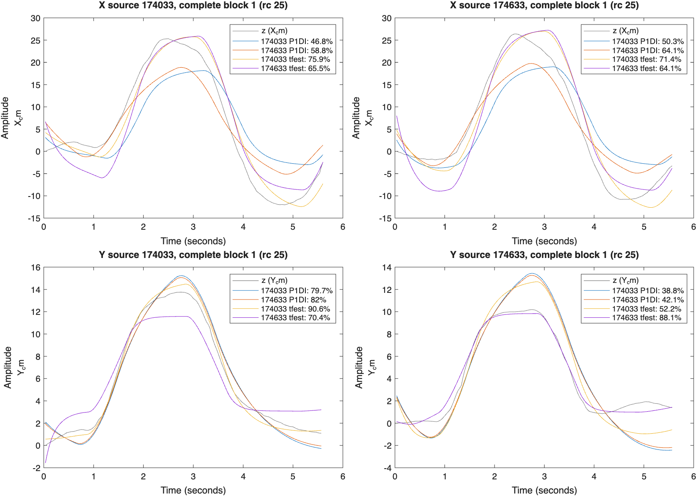

# 真機系統辨識交接：2026-11-10

## 結論與交付範圍

**已完成四次真機資料整理、後兩次初步模型估算，以及既有模型的離線品質／跨次驗證；目前尚未取得驗證通過、可直接用於控制器設計的可靠真機模型。**

本次補上文件、可重現的離線審核程式、JSON / CSV / MAT 結果與比較圖。沒有修改飛行控制、追蹤器、激振設定、正式 model.json 或 gains.json，也沒有自動起飛、重做真機實驗或上傳 GitHub。後續改進是待辦，並非已實作功能。

## 四份資料的狀態

| 日期時間尾碼 | 列數 | 結束原因 | 現有辨識輸出 | 通過初步完整性／追蹤篩選的名義測試段 |
|---|---:|---|---|---|
| 171015 | 928 | GOTO timeout | 無 | 1/2 |
| 172242 | 2390 | left the safe area at X=2, Y=-120 cm | 無 | 6/10 |
| 174033 | 2580 | identification program finished | 有兩軸 MAT / PNG | 5/10 |
| 174633 | 2530 | identification program finished | 有兩軸 MAT / PNG | 5/10 |

篩選是輔助檢查，不保證位置量測正確。保留全部原始資料；未完成的兩次沒有被自動重估為正式模型，但其通過篩選的片段納入既有模型的額外比較。

## 已保存的 P1DI 初步結果

輸入為實際紀錄的 rc_a / rc_c，輸出為相機校正後的牆面座標 X / Y（cm）：

`G(s) = Kv * exp(-L*s) / (s * (tau*s + 1))`

| run | 軸 | Kv (cm/s/rc) | tau (s) | L (s) | 原程式保留驗證 fit |
|---|---|---:|---:|---:|---|
| 174033 | X | 1.0806 | 0.3443 | 0.5665 | 60.5% / 61.7% |
| 174033 | Y | 0.9977 | 0.8956 | 0.0000 | 77.0% / 86.9% / 83.4% |
| 174633 | X | 1.6108 | 0.8694 | 0.0198 | 64.8% / 64.1% |
| 174633 | Y | 0.9585 | 0.8676 | 0.0000 | 69.3% / 67.3% |

數值直接讀取兩次 matlab_sysid.mat，沒有選最高分片段或將兩次參數平均成「最終模型」。原程式另有 tfest 模型，其分數及模型物件保留在原 MAT 與本次 audit MAT / JSON 中。

fit 是整段模擬的 NRMSE 指標 `100*(1-norm(y-yhat)/norm(y-mean(y)))`，不是量測誤差百分比或一步預測準確率。compare 會逐段估計初始狀態；不是全程從零狀態模擬。

174033 的 Y 原程式列出三個驗證分數，是因追蹤／excite_axis 間隔讓同一名義測試段被拆開；**不是三次獨立的完整大振幅實驗**。

## 本次新增的離線驗證

`matlab/audit_real_sysid.m` 讀取原模型、log 與 meta，不重新估算或修改動態參數。用 meta.events 的 EXCITE / GOTO 時間還原「名義測試段」，避免把短暫追蹤中斷當成額外獨立實驗。

初步篩選條件為：未觸發段落範圍中止、有效位置比例至少 98%、含前後緩衝的最大有效位置間隔不超過 0.2 s、框高度最大／最小比不超過 2.2。這些是本次資料品質啟發式，不是製造商標準、飛行安全限制或正確追蹤的證明。低於起飛門檻 30% 另行標記，不會偷偷刪掉，也不等於可忽略電量效應。

共 17 個段落通過這層篩選。每段同時比較 174033 / 174633 的 P1DI 與 tfest，並記錄 P1DI 的殘差相關診斷。各資料來自模型自己的估算段、保留驗證段或另一輪資料，都在 CSV 中標記。

重要結果：

- 174033 的 X P1DI 套用到 174633 兩個完整 rc=25 段，fit 約 **50.3% / 60.8%**。
- 174633 的 X P1DI 套用到 174033 兩個完整 rc=25 段，fit 約 **58.8% / 57.0%**。
- 174033 的 Y P1DI 套用到 174633 前三個通過篩選段，fit 約 **38.8% / 42.4% / 67.4%**；該輪 Y 電量只有 17–16%，不能把差異全部歸因於動態模型。
- 174633 的 Y P1DI 套用到 174033 前三段，fit 約 **82.0% / 70.7% / 78.8%**；其中前兩段是 174033 模型的估算來源，對 174633 模型而言才是跨次資料。
- 本次逐段檢查的 P1DI 殘差仍有明顯時間相關及輸入相關，沒有通過使用逐 lag 99% 參考界線的診斷。這是診斷訊號，未做多重比較校正，也不能單靠它指定某個唯一物理原因。

審核分數依名義事件邊界取前 0.6 秒與後 1 秒，再以 1/30 秒重採樣，可能與原程式依 excite_axis 間隔切段的分數略有不同。CSV 與原 MAT 分數分開保存，不互相覆蓋。



圖中每欄來自該輪第一個完整小振幅段；對該輪自己的模型屬估算來源，對另一輪模型屬跨次檢查，不能把四條曲線全部宣稱為獨立驗證。

## 問題證據與判斷

### 激振被截斷、資訊不足

兩個 finished run 的 X 大振幅段 x3 / x4 均觸發約 65–68 cm 範圍保護，沒有完整正反向反應。174633 的 X PRBS 在截斷前沒有非零正負切換，近似單向推動。截斷本身不代表資料全無價值，但不足以提供原設計的完整激振資訊。

### 追蹤品質

Y 出現 NaN、框尺寸縮小、位置跳動，174033 的一個名義大振幅段被原切段程式拆成兩段。valid=1 只表示追蹤器有位置輸出，其中可能含 Kalman 短時預測；仍需對照影片確認鎖定物體。原程式對缺測位置直接線性插值，尚未依缺口長度拒用。

### 電量變化

174033 起飛約 48%，Y 期間降至約 34–22%；174633 起飛約 38%，Y 期間只有約 17–14%。172242 曾從起飛約 33% 降至末段約 9%，高度回報 0。這些是明確實驗變因；僅靠目前資料不能量化電量對 fit 的影響或確定機內保護是否觸發。

目前只在起飛前以 min_battery=30 檢查，飛行中尚未持續依電量門檻降落。此缺口在本次只記錄為待辦，未宣稱已修好。

### 參數不穩定

X 延遲從 0.5665 s 變為 0.0198 s，Y 延遲兩次均到 0 下限。這表示延遲與其他參數仍未可靠辨識，不能把 L=0 當成設備沒有延遲。沒有證據支持直接將兩組參數平均後用於飛行。

## 下一個人應優先做的改進

1. **飛行前先補電量處理與可觀測性**：飛行中持續檢查新鮮電量、低電量要求降落；門檻、遲滯／持續時間及失去遙測的策略需明確設定。記錄中止原因；測試先用模擬或 mock，真機由人監看。也應確認相機幀阻塞時能否持續送出保護指令。現有保護機制不能當成保證。
2. **量測先行**：對照相機影片人工檢查框；改善光線、背景、遮擋與相機固定。加入尺寸／位移一致性、偵測與預測狀態的區別。偵測信心不等於正確定位，拒絕異常值時仍需處理失去追蹤。
3. **調整激振設計**：降低振幅或縮短脈衝，讓正向、反向與尾段能在既有工作範圍內完整執行。不要以放寬安全範圍當作首選。PRBS 振幅在 makeProgram 目前寫死為 30、持續時間也未參數化，只改 amps 不會一起降低 PRBS，需一併參數化與驗證。
4. **縮短單次實驗、控制條件**：充足電量、固定機頭／相機／離牆距離，考慮 X、Y 分次測試並由辨識端合併結果。維持兩種振幅與保留驗證；單軸結果不能直接覆寫成完整兩軸模型。simWind 只影響模擬，改成 0 不會消除真機場地風擾。
5. **資料與辨識流程**：依名義測試事件切段，標記截斷與長缺測，避免跨長缺口插值或把碎片當獨立驗證。先看延遲、比較 Focus='simulation' 與適當漂移模型，再視殘差決定是否增加模型階數。fit 要同時報估算、保留驗證與跨次結果，加入參數不確定性；不要只挑最高分。
6. **補測與接受條件**：至少取得完整、可靠追蹤、電量條件相近的估算與獨立驗證實驗。接受標準由組內依控制用途事先訂定，不能只看 fit 單一數字；需有物理合理且跨次穩定的參數、可解釋的殘差、可用的有效頻帶。通過後才備份、寫回 model.json、設計 PID，再分階段驗證閉迴路。

以上改進是下一輪工作，不是本次程式已具備的功能；尚未新增任何可以直接視為已驗證的真機參數組合。

## 重現本次審核

在 MATLAB 的專案 matlab 資料夾執行，不需無人機、攝影機或網路：

```matlab
projectRoot = fileparts(pwd);
A = audit_real_sysid(projectRoot);
```

預設輸出 runs/sysid_review_20261110/。重跑會更新審核 JSON / CSV / MAT / PNG，不改原始 run、原始 MAT 或正式設定。中文交接與 results_summary.json 是本次整理快照。

檔案：

- real_sysid_audit.json：四次品質、兩次原模型摘要、分段比較與殘差診斷。
- screened_model_comparison.csv：適合試算表閱讀的 17 段比較。
- real_sysid_audit.mat：完整審核與既有模型、分段 iddata。
- cross_run_comparison.png：跨次曲線。
- results_summary.json：便於其他工具讀取的初步狀態與參數快照。
- provenance.json：來源檔 SHA256，用於核對資料與原始設定。

## 上傳與交接

保留四次完整的原始 run，以及上述新增文件／審核結果。大型 camera_half.mp4 已被原 .gitignore 排除，請另外備份到組內雲端，對應日期時間與 tag；不要只上傳比較圖而遺失 log.csv、meta.json 與 matlab_sysid.mat。

本地是 GitHub ZIP 解壓資料夾，沒有 .git。本次未初始化 Git、commit、push 或發布任何資料。提供的壓縮包是待人工上傳／合併的相對路徑檔案集合，不是已提交到遠端的變更。

## 可直接貼給組長的摘要

> 已取得四次 Tello 真機辨識紀錄，其中兩次流程結束並完成 X/Y 的 P1DI 與 tfest 初步估算。已整理原始參數、資料品質及跨次驗證。X 原保留驗證約 60–65%，Y 約 67–87%，但 X 大振幅段均被截斷，Y 有追蹤與低電量疑點，延遲參數亦不穩定。因此目前完成的是「初步模型估算與問題定位」，尚未接受為正式控制模型，未更新模型或 PID。下一步先修正量測、激振與電量處理，再補完整且條件一致的驗證資料。
